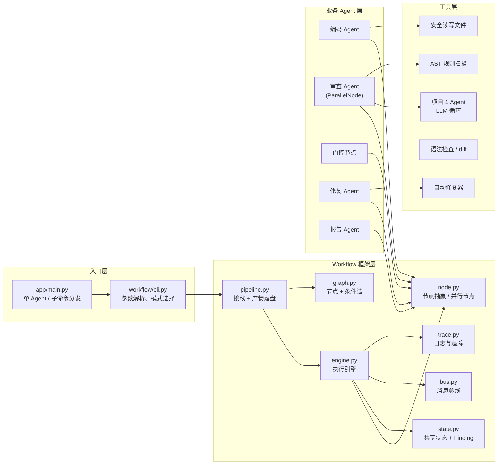
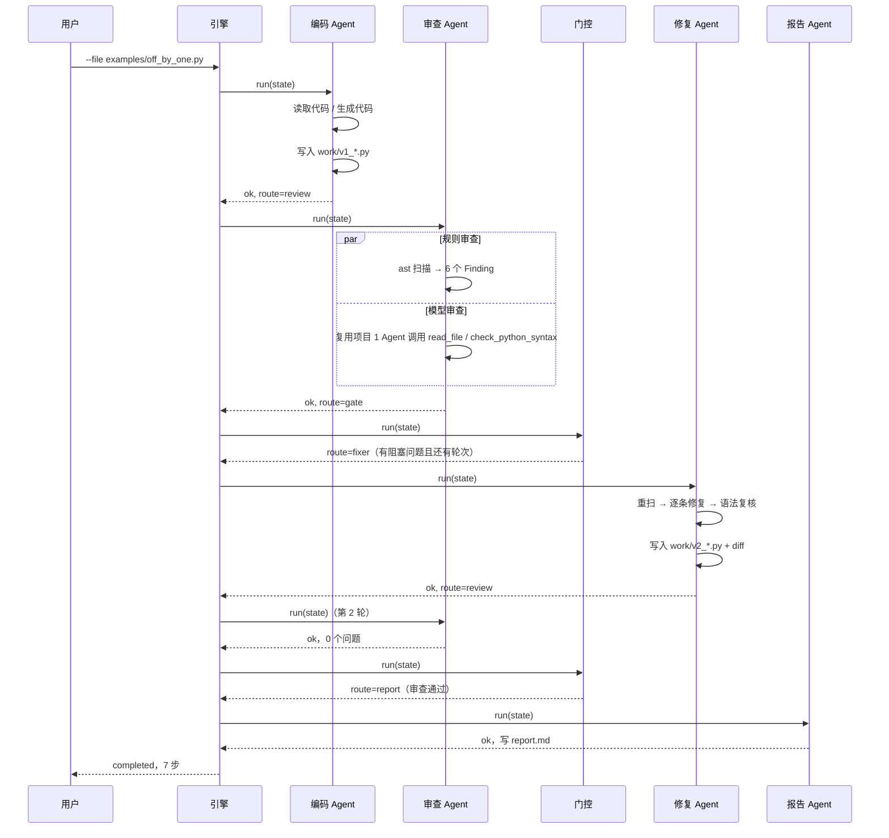

# 设计说明

## 1. 目标与范围

作业 2 要求用一个可运行的 MVP 讲清楚三件事：**Workflow 编排**、**Agent 间通信**、**状态管理**。
因此本项目选择的重点是“把框架的边界划清楚”，而不是堆更多审查规则：

- 框架层（`app/workflow/`）与业务层（`app/agents/`、`app/tools/`）彻底分离；
- 业务变化（换方向、加 Agent、改流程）只改业务层与 `pipeline.py` 的接线；
- 框架层只依赖“节点”和“状态”两个概念，不知道“代码审查”是什么。

选定的方向是“代码审查流程”：**编码 → 审查 → 修复**，并额外加一个报告节点。

## 2. 总体架构



关键约束：

- 引擎不认识 Agent 的名字，只认识 `Node`（有 `name` / `run`）与 `Edge`（条件）；
- Agent 不决定下一步去哪，只返回 `NodeResult(status, summary, route)`；
- **唯一描述“谁接谁”的地方是 `pipeline.build_workflow`**。

## 3. 核心抽象

| 模块 | 职责 | 关键设计 |
|------|------|----------|
| `state.WorkflowState` | 全流程唯一的事实来源：输入、代码版本、问题列表、轮次、历史、产物 | Agent 只读写它，不互相直接调用；`fork()` 给并行节点用 |
| `state.Finding` | 结构化问题（规则号、级别、位置、建议、是否可自动修复） | 门控按 `severity` 判断，修复按 `rule_id` 选修复器，报告渲染成表格 |
| `bus.MessageBus` | 广播 / 定向消息 + 主题查询 | 每步都发消息，`messages.json` 可回放 Agent 通信 |
| `node.AgentNode` | 节点模板：`run` 统一捕获异常，子类只写 `handle` | 异常转为 `NodeResult(failed)`，交给错误分支 |
| `node.ParallelNode` | 并行执行子节点并合并结果 | 子节点拿状态副本，按声明顺序合并，结果可复现 |
| `graph.Workflow` | 节点集合 + 边集合 + 校验 + 图导出 | `validate()` 检查未知端点、不可达节点、无终止节点 |
| `graph.Edge` | `when`（success/error/always）+ `condition` 回调 | 按定义顺序取第一条命中的边 |
| `engine.WorkflowEngine` | 推进、重试、循环守卫、记录每一步 | `max_steps` 防全局失控，`max_visits` 防单节点死循环 |
| `trace.TraceRecorder` | 控制台日志 + `trace.jsonl` | 每事件带耗时，便于定位慢节点 |
| `pipeline` | 组装、运行、写产物 | `run_workflow()` 一次调用完成全流程 |

## 4. 一次运行的时序



## 5. 流程控制

### 5.1 顺序执行

节点返回 `ok`，引擎按边顺序找第一条命中的边。没有出边即结束。

### 5.2 条件分支

门控节点返回 `route`，引擎优先采用显式路由；图上的边同时作为兜底与可视化声明：

```python
# app/agents/gate.py（节选）
if not blocking:
    decision = "report"          # 没有阻塞问题 → 直接出报告
elif state.round >= state.max_rounds:
    decision = "report"          # 轮次用尽 → 出报告并提示人工
else:
    decision = "fixer"           # 还有得修 → 回到修复
return NodeResult(summary=reason, route=decision)
```

### 5.3 循环

`fixer → review` 是一条指向上游的边。退出条件有两层：

1. 业务层：门控比较 `state.round` 与 `state.max_rounds`；
2. 框架层：引擎统计每个节点的访问次数，超过 `max_visits`（默认 8）直接中止并标记 `aborted`，
   避免任何配置错误变成死循环。

### 5.4 并行

审查 Agent 是 `ParallelNode`，规则审查与模型审查同时跑：

```python
ReviewerAgent(StaticReviewNode(reader), LLMReviewNode(llm, registry))
```

子节点拿到的是 `state.fork()` 副本，父节点按**声明顺序**合并问题与事件，
所以线程完成顺序不影响结果（测试里验证了“上一轮问题不会重复带入”）。

### 5.5 错误分支

边可以声明 `when="error"`，只在节点失败时生效。当前图里每个关键节点都有一条错误边直达报告节点，
所以“编码失败 / 审查失败 / 修复失败”时流程不会崩，而是产出一份说明失败原因的报告：

```text
coder  --编码完成-->  review
coder  --编码失败-->  report      # when="error"
review --审查完成-->  gate
review --审查失败-->  report      # when="error"
```

## 6. 状态管理与 Agent 通信

### 6.1 共享状态

所有 Agent 读写同一个 `WorkflowState`。为了避免“隐式耦合”，字段的用途固定：

| 字段 | 写入方 | 读取方 |
|------|--------|--------|
| `source_path` / `requirement` | 入口 | 编码 Agent |
| `code` / `work_path` / `original_code` | 编码、修复 | 审查、修复、报告 |
| `findings` | 审查（每轮整体替换） | 门控、修复、报告 |
| `round` | 编码（初始化 1）、修复（+1） | 门控、报告 |
| `history` | 审查（每轮记录） | 报告 |
| `artifacts` | 各 Agent 的产物（版本、diff、路径、运行结果） | 报告、CLI |

`findings` 采用“整轮替换”而不是增量追加：每轮审查都是一次完整结论，
否则修复后旧问题会一直残留，门控永远无法通过。

### 6.2 消息总线

| 主题 | 发送方 | 接收方 | 载荷 |
|------|--------|--------|------|
| `coder.start` | 编码 | 广播 | 需求、源路径 |
| `code.ready` | 编码 | 审查 | 版本文件路径、行数 |
| `review.static.done` | 规则审查 | 审查 | 问题数、命中的规则 |
| `review.llm.done` / `.error` | 模型审查 | 审查 | 字数 / 错误 |
| `review.done` | 审查 | 门控 | 本轮问题列表与各级计数 |
| `gate.decision` | 门控 | 广播 | 决策、原因、阻塞数 |
| `fix.done` | 修复 | 审查 | 修复条数、失败条数、新版本路径 |
| `report.written` | 报告 | 用户 | 报告路径 |

消息的全部内容写入 `messages.json`，可以在报告或调试时回放“每个 Agent 当时看到了什么”。

## 7. 修复的安全策略

修复 Agent 是本项目唯一会改写代码的节点，因此约束最严：

1. **只改可自动修复的问题**：`Finding.auto_fixable` 为假的问题原样保留，只输出建议；
2. **每次修复前重新扫描**：`ast` 的位置信息只对当前源码有效，修复一条后必须重新取位置；
3. **每次修复后重新 `ast.parse`**：语法校验失败就丢弃这条修改，原代码不变（记入失败列表）；
4. **原子写入新版本**：不覆盖原始输入文件，每个版本都是 `work/vN_*.py`；
5. **保留 diff**：报告里能看到每轮改了什么，便于人工复核。

```python
new_source, note = apply_fix(current, finding)
if new_source is None:      # 修复失败
    blocked.add(finding.rule_id)
    failed.append(...)
    continue                # 跳过该规则，继续尝试其他问题
current = new_source        # 修复成功
```

## 8. 错误处理与恢复

| 层级 | 机制 | 行为 |
|------|------|------|
| 节点内 | `AgentNode.run` 捕获异常 | 转为 `failed` 结果，附带异常类型与信息 |
| 引擎 | `max_retries`（默认 1 次） | 失败节点立即重试，失败信息写入 `trace.jsonl` |
| 图 | `when="error"` 边 | 走错误分支出报告，而不是整体崩溃 |
| Agent | 模型不可用降级 | `LLMReviewNode` 捕获异常并返回 `skipped`，规则审查照常进行 |
| 修复 | 语法复核失败回滚 | 该条修改作废，其余修复继续 |
| 引擎 | `max_steps` / `max_visits` | 循环失控时中止并标记 `aborted` |

端到端测试 `test_missing_source_routes_to_error_branch` 覆盖了“输入文件不存在 → 编码失败 → 错误边 → 出报告”的完整路径。

## 9. 可扩展性

**加一个新 Agent（例如“安全审计 Agent”）只需三步**，不用改引擎：

```python
# 1) 写节点
class SecurityAuditNode(AgentNode):
    def __init__(self):
        super().__init__("security", "安全审计 Agent")
    def handle(self, state, bus):
        findings = my_checks(state.code)
        state.replace_findings(state.findings + findings)
        return NodeResult(summary=f"发现 {len(findings)} 个安全问题")

# 2) 在 pipeline.build_workflow 里插进图
workflow.add_node(SecurityAuditNode())
workflow.add_edge("coder", "security", label="编码完成")
workflow.add_edge("security", "review", label="审计完成")

# 3) 没有第 3 步：报告、日志、消息、产物都会自动带上它
```

**改流程**同理：只改 `add_edge`。例如把“修复后复审”改成“修复后直接出报告”，删掉 `fixer → review` 这条边即可。

**加规则**：在 `static_rules.RULE_CATALOG` 注册元信息，再写一个 `_check_xxx` 并在 `scan()` 里调用；
如果需要自动修复，在 `autofix.FIXERS` 里注册修复器即可，报告与修复 Agent 自动识别。


## 10. 产物与可追踪性

每次运行一个目录，全部可复现：

| 文件 | 内容 | 用途 |
|------|------|------|
| `report.md` | 报告正文 + 执行记录 | 交付物 |
| `trace.jsonl` | 逐事件日志（时间、节点、状态、耗时） | 排错、演示 |
| `state.json` | 最终状态快照（问题、轮次、历史、产物） | 复现问题 |
| `messages.json` | Agent 间消息 | 讲解通信过程 |
| `run.json` | 图定义 + 状态 + 消息 + 运行结果 | 完整存档 |
| `workflow.mmd` | mermaid 拓扑源码 | 文档/幻灯片 |
| `work/vN_*.py` | 每个代码版本 | 对比修复前后 |

## 11. 已知限制与后续方向

- 规则审查只覆盖 10 类 Python 常见问题，未接入 Ruff/Pylint 等成熟工具（接入方式同第 9 节，写一个节点即可）；
- 自动修复目前是“规则改写”，不做跨函数语义重构；
- 模型审查以自然语言为主，还没有把模型输出解析成结构化 `Finding`（可新增一个“解析节点”把两者合并）；
- 并行目前是节点内的线程级并行；如需真正的 DAG 并行调度，可把引擎的“单当前节点”改成“待执行节点集合”；
- 没有 Web 界面；报告已经是 Markdown，必要时可以直接渲染成网页。
