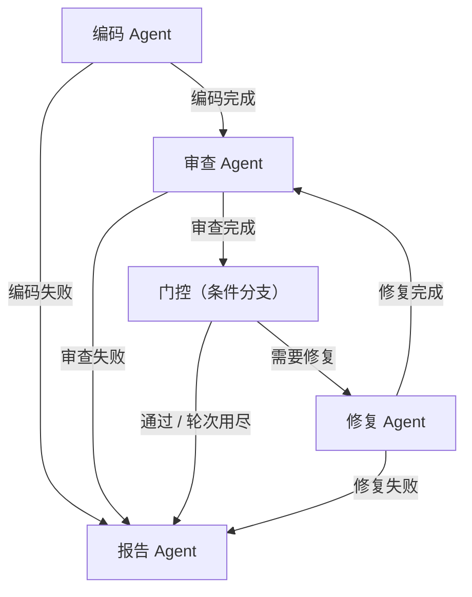

# 代码审查 Workflow 报告

- 工作流：`code-review-workflow`
- 输入：`examples/multi_issue.py`
- 当前代码版本：`runs/20261020-085118-2/work/v2_multi_issue.py`
- 轮次：2 / 3（阻塞阈值：高）

## 1. 概览

| 指标 | 数值 |
|------|------|
| 审查轮次 | 2 |
| 问题总数 | 6（高 4 / 中 1 / 低 1） |
| 自动修复条数 | 3 |
| 代码版本数 | 2 |

## 2. Workflow 拓扑



## 3. 审查与修复过程

### 第 1 轮审查（9 个问题）

| 级别 | 规则 | 位置 | 问题 | 建议 |
|------|------|------|------|------|
| 高 | PY008 疑似硬编码密钥 | 第 4 行第 1 列 | 变量 API_TOKEN 被直接赋值为字符串常量，疑似硬编码密钥 | 从环境变量或配置中读取，不要把密钥写进源码。 |
| 中 | PY002 可变默认参数 | 第 7 行第 28 列 | 函数 load_items 的参数默认值是可变对象，多次调用会共享同一份数据 | 把默认值改成 None，并在函数体内判断后重新赋值。 |
| 低 | PY010 open 未使用 with | 第 8 行第 14 列 | open() 没有放在 with 语句里，异常时可能无法及时关闭文件 | 使用 with open(...) as f，确保异常时也能关闭文件。 |
| 高 | PY007 使用 os.system/os.popen | 第 14 行第 5 列 | 使用 os.system 执行 shell 命令，命令拼接存在注入风险 | 改用 subprocess.run 并以列表传参。 |
| 高 | PY005 subprocess shell=True | 第 15 行第 5 列 | subprocess.run(shell=True) 会把参数交给 shell 解释，存在命令注入风险 | 以列表形式传参并去掉 shell=True，避免命令注入。 |
| 低 | PY006 与 None 比较使用 == | 第 19 行第 8 列 | 使用 == None 判断空值，应改用 is None（可自动修复） | 判断 None 应使用 is / is not。 |
| 高 | PY004 使用 eval/exec | 第 22 行第 16 列 | 调用 eval() 执行字符串代码，输入不可信时等同于远程代码执行 | 改用显式解析（ast.literal_eval、json.loads 或专门的解析函数）。 |
| 中 | PY003 裸 except | 第 23 行第 5 列 | 使用了裸 except，会一并吞掉 KeyboardInterrupt 和 SystemExit，排查问题时难以定位（可自动修复） | 明确捕获 Exception 或具体异常类型，避免吞掉 KeyboardInterrupt/SystemExit。 |
| 高 | PY001 range 越界风险 | 第 29 行第 14 列 | range(len(values) + 1) 比可索引范围多 1，循环到最后一轮时 values[i] 会抛 IndexError（可自动修复） | 循环上界多加了偏移量，索引会越界；去掉多余的加减项。 |

**第 2 轮修复**：3 条已修复，0 条需人工处理；版本 `runs/20261020-085118-2/work/v2_multi_issue.py`

```diff
--- runs/20261020-085118-2/work/v1_multi_issue.py
+++ runs/20261020-085118-2/work/v2_multi_issue.py
@@ -16,16 +16,16 @@
 
 
 def parse(text):
-    if text == None:
+    if text is None:
         return None
     try:
         return eval(text)
-    except:
+    except Exception:
         return None
 
 
 def score(values):
     total = 0
-    for i in range(len(values) + 1):
+    for i in range(len(values)):
         total += values[i]
     return total
```

### 第 2 轮审查（6 个问题）

| 级别 | 规则 | 位置 | 问题 | 建议 |
|------|------|------|------|------|
| 高 | PY008 疑似硬编码密钥 | 第 4 行第 1 列 | 变量 API_TOKEN 被直接赋值为字符串常量，疑似硬编码密钥 | 从环境变量或配置中读取，不要把密钥写进源码。 |
| 中 | PY002 可变默认参数 | 第 7 行第 28 列 | 函数 load_items 的参数默认值是可变对象，多次调用会共享同一份数据 | 把默认值改成 None，并在函数体内判断后重新赋值。 |
| 低 | PY010 open 未使用 with | 第 8 行第 14 列 | open() 没有放在 with 语句里，异常时可能无法及时关闭文件 | 使用 with open(...) as f，确保异常时也能关闭文件。 |
| 高 | PY007 使用 os.system/os.popen | 第 14 行第 5 列 | 使用 os.system 执行 shell 命令，命令拼接存在注入风险 | 改用 subprocess.run 并以列表传参。 |
| 高 | PY005 subprocess shell=True | 第 15 行第 5 列 | subprocess.run(shell=True) 会把参数交给 shell 解释，存在命令注入风险 | 以列表形式传参并去掉 shell=True，避免命令注入。 |
| 高 | PY004 使用 eval/exec | 第 22 行第 16 列 | 调用 eval() 执行字符串代码，输入不可信时等同于远程代码执行 | 改用显式解析（ast.literal_eval、json.loads 或专门的解析函数）。 |


## 4. 遗留问题（需人工处理）

仍有 4 个达到阻塞阈值的问题：

| 级别 | 规则 | 位置 | 问题 | 建议 |
|------|------|------|------|------|
| 高 | PY008 疑似硬编码密钥 | 第 4 行第 1 列 | 变量 API_TOKEN 被直接赋值为字符串常量，疑似硬编码密钥 | 从环境变量或配置中读取，不要把密钥写进源码。 |
| 中 | PY002 可变默认参数 | 第 7 行第 28 列 | 函数 load_items 的参数默认值是可变对象，多次调用会共享同一份数据 | 把默认值改成 None，并在函数体内判断后重新赋值。 |
| 低 | PY010 open 未使用 with | 第 8 行第 14 列 | open() 没有放在 with 语句里，异常时可能无法及时关闭文件 | 使用 with open(...) as f，确保异常时也能关闭文件。 |
| 高 | PY007 使用 os.system/os.popen | 第 14 行第 5 列 | 使用 os.system 执行 shell 命令，命令拼接存在注入风险 | 改用 subprocess.run 并以列表传参。 |
| 高 | PY005 subprocess shell=True | 第 15 行第 5 列 | subprocess.run(shell=True) 会把参数交给 shell 解释，存在命令注入风险 | 以列表形式传参并去掉 shell=True，避免命令注入。 |
| 高 | PY004 使用 eval/exec | 第 22 行第 16 列 | 调用 eval() 执行字符串代码，输入不可信时等同于远程代码执行 | 改用显式解析（ast.literal_eval、json.loads 或专门的解析函数）。 |

## 5. 最终代码

```python
import os
import subprocess

API_TOKEN = "demo-token-not-real"


def load_items(path, cache=[]):
    handle = open(path, "r", encoding="utf-8")
    data = handle.read()
    return data


def run_command(user_input):
    os.system("echo " + user_input)
    subprocess.run("ls " + user_input, shell=True)


def parse(text):
    if text is None:
        return None
    try:
        return eval(text)
    except Exception:
        return None


def score(values):
    total = 0
    for i in range(len(values)):
        total += values[i]
    return total
```

## 6. 执行记录

| 步 | 节点 | 状态 | 耗时(ms) | 说明 | 下一步 |
|----|------|------|----------|------|--------|
| 1 | 编码 Agent | ok | 19 | 读取已有代码，共 31 行 → runs/20261020-085118-2/work/v1_multi_issue.py | review |
| 2 | 审查 Agent | ok | 5 | 第 1 轮审查：9 个问题（高 5） | gate |
| 3 | 门控（条件分支） | ok | 0 | 仍有 5 个「高」级问题，进入第 2 轮修复 | fixer |
| 4 | 修复 Agent | ok | 14 | 第 2 轮修复：3 条已修复，0 条需人工 | review |
| 5 | 审查 Agent | ok | 12 | 第 2 轮审查：6 个问题（高 4） | gate |
| 6 | 门控（条件分支） | ok | 0 | 仍有 4 个「高」级问题，进入第 3 轮修复 | fixer |
| 7 | 修复 Agent | skipped | 2 | 没有可自动修复的问题，直接出报告 | report |
| 8 | 报告 Agent | ok | 3 | 报告已生成：runs/20261020-085118-2/report.md | - |

### 运行结论

- 状态：**completed**
- 停止原因：在节点 report 结束（无后续边）
- 总耗时：0.06 秒
- 步骤数：8
- 总线消息：11 条
- 追踪事件：21 条（见 `trace.jsonl`）
